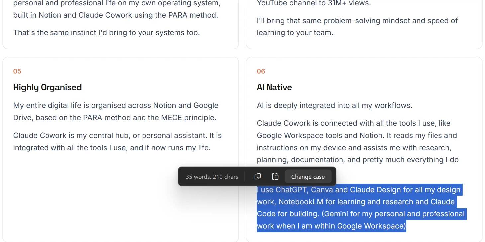
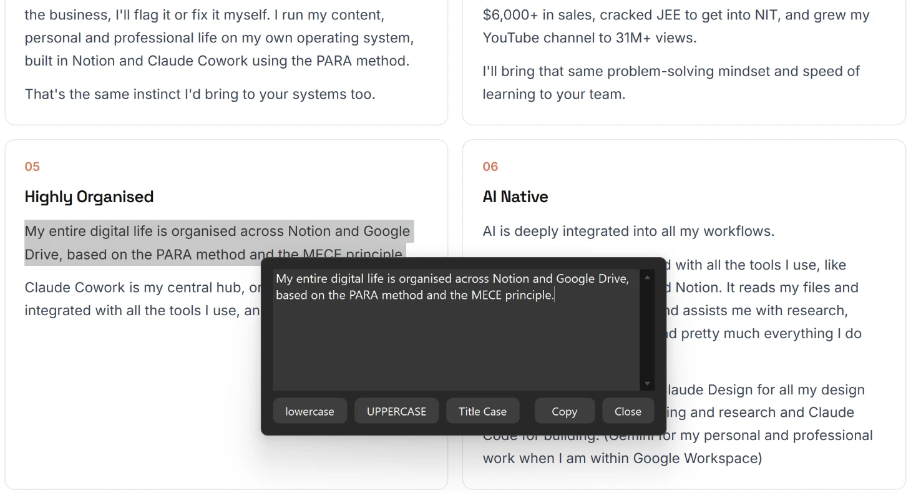
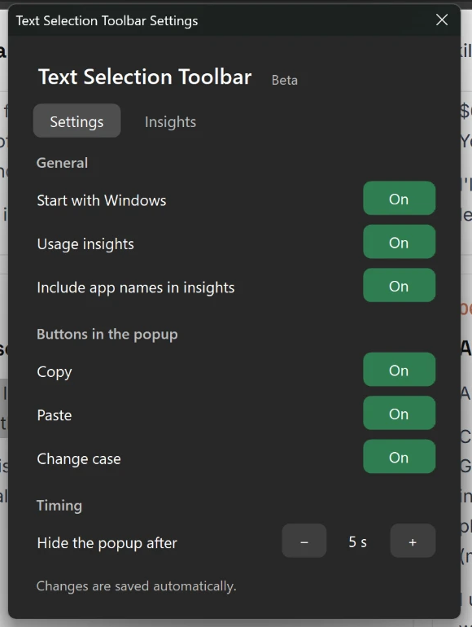
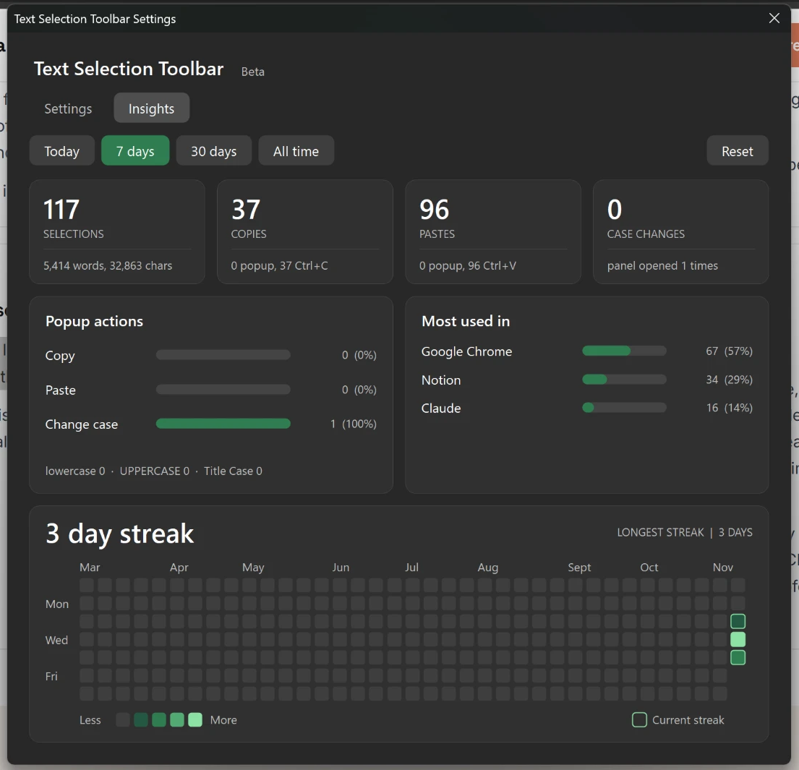

# Text Selection Toolbar

**Bottom line:** Text Selection Toolbar is a small Windows app, now in **Beta**. Select text in almost any app, and a popup instantly shows the word count and character count. It also gives you Copy, Paste and a Change case panel (lowercase, UPPERCASE, Title Case). I built it with Claude Code to stop copying text into random websites just to check its length.

## Where it works

It reads text you select with the mouse, or with Ctrl+A, in other apps. I confirmed it in these apps myself:

| App | Status |
|---|---|
| Google Chrome (any web page) | Works |
| ChatGPT in Chrome | Works |
| LinkedIn in Chrome | Works |
| PDF files opened in Chrome | Works |
| Claude (desktop app) | Works |
| Notion (desktop app) | Works |
| Notepad | Works |

**Not tested yet:** the installed ChatGPT app, X, LinkedIn app, Grok and other apps. I am testing more apps and will list every exception.

**Skipped on purpose:** a few apps where pressing Ctrl+C can mean something else, so the app does not use that fallback there.

- File Explorer
- Windows Terminal, PowerShell and the command prompt
- Excel
- Premiere Pro
- Screenshot tools such as Snipping Tool

**May not work:** apps running as administrator, and some games.

No tool can work in literally every app. This one aims at the apps I use every day.

## Links

| What | Where |
|---|---|
| My portfolio | https://pawankushwaha.com/portfolio/ |
| My blog | https://pawankushwaha.com |
| Other projects on my GitHub | [Popular Recently for YouTube](https://github.com/Pawankkushwaha/Popular-Recently-for-YouTube), [YouTube Goal Tracker](https://github.com/Pawankkushwaha/yt-goal-trackerr), [Claude Editing System for Premiere Pro](https://github.com/Pawankkushwaha/claude-premiere-editing-system) |
| YouTube | https://www.youtube.com/@pawan.kkushwaha |

## What it looks like

**The popup: word count, character count, Copy, Paste and Change case**

**The Change case panel**

**Settings**

**Insights: my own usage over 7 days, counts only**

## The problem

Whenever I write on my laptop, I edit my text again and again. Most places I post on have a limit on length, so I need to know how long my text is.

Here are the limits I hit most often:

- **YouTube:** a video title can have up to 100 characters.
- **Instagram:** a caption can have up to 2,200 characters, and a post can have up to 30 hashtags.
- **LinkedIn:** a post can have up to 3,000 characters.
- **X:** a standard post can have up to 280 characters.
- **My blog and other pages:** page titles, descriptions and summaries also need a set length to read well in search results.

I also change the case of text often:

- Video and article titles look best in Title Case.
- URLs, slugs and tags need lowercase.
- Headings or short labels sometimes need UPPERCASE.
- Text I copied from somewhere else can arrive in the wrong case.

Every time, the process was the same. I copied my text. I opened Chrome. I searched for a website that counts characters or changes case. I pasted my text, read the result and went back to my work.

It was a small task, but it was manual, it broke my focus, and it happened many times a day. So I built a simple Windows app. Now when I select text, the count and the options are right there.

## Already built

| Feature | What it does | How it is built |
|---|---|---|
| Popup on selection | Appears next to the selected text and hides after 5 seconds | A system-wide mouse watcher and Windows UI Automation, with a brief Ctrl+C as a fallback |
| Word and character count | Shows both for the selected text | Plain C# counting that handles line breaks, extra spaces and emoji |
| Copy and Paste buttons | Copy the selection, or paste over it | Windows clipboard and keyboard commands |
| Change case panel | Shows the selected text in a box, with lowercase, UPPERCASE, Title Case and Copy | A small WinForms window |
| Select all (Ctrl+A) | Shows the same popup after Ctrl+A | A keyboard watcher that looks only at Ctrl+A |
| Tray control | Switch the whole tool on or off by double-clicking the tray icon | A WinForms tray icon that shows the on or off state |
| Settings | Turn each button on or off, and set the hide time from 2 to 30 seconds | A WinForms settings window, saved automatically |
| Start with Windows | Starts the app when I sign in, with an off switch | One entry in the current user's startup list, no admin rights |
| Insights | Local usage counts: selections, copies, pastes, case changes, most used apps and streaks | A local JSON file, shown in a dashboard |
| Hover hints and auto-pause | The hide timer pauses while the mouse is over the popup | WinForms timers and tooltips |

## Privacy: what it touches

- **Selected text:** it is read only on my PC and is never sent anywhere. The app has no network code.
- **Clipboard:** in some apps (Claude and sometimes Chrome) the app presses Ctrl+C to read the selection, then puts your old clipboard back. Because of this, Windows clipboard history (Win+V) can record those selections.
- **Keyboard watchers:** the Ctrl+A watcher is on whenever the tool is on. The Ctrl+C and Ctrl+V counter runs only while Insights is on. Both look only at those keys and ignore everything else.
- **Insights:** it stores counts only, on this PC, and never the selected text. App names are optional. There is an off switch and a Reset button.
- **Start with Windows:** it is on by default, with a switch in Settings.

## Known limits

- **Ctrl+A support is the newest feature.** It is still being tested.
- **Title Case turns "iPhone" into "Iphone".** It lowercases words first so ALL CAPS text converts well.
- **The Change case panel only copies the result.** It does not replace the selected text in the other app yet.
- **There is no guard against opening the app twice.** A second copy gives two popups.
- **The popup can look off at some display scales.** I fixed this for 200% scaling and keep testing others.

## Not built yet

These are ideas, not promises.

- An Insert action
- Cut, Search and other extra buttons
- Letting users add their own actions
- Replacing the selected text from the Change case panel
- Automatic updates
- A phone version
- Testing in more apps, with a full list of exceptions

## Built with

| Layer | Tool |
|---|---|
| Builder | Claude Code |
| Language and platform | C# on .NET 10, Windows only |
| Windows UI | WinForms (WPF only for Windows' own UI Automation classes) |
| Reading selected text | Windows UI Automation, plus a Ctrl+C fallback |
| Mouse and keyboard watching | System-wide Windows hooks |
| Start with Windows | A current-user startup registry entry |
| Settings and Insights | Local JSON files |
| Icons | Windows' own icon font, so no icon files are bundled |
| Packages | None. The project uses no extra NuGet packages |
| Version control | Git |

## How I built it

I agreed on the smallest version first and built it in steps:

1. Set up an empty tray app.
2. Read the selected text. This was the riskiest step, so I tested it first.
3. Show the popup with auto-hide.
4. Add Copy and Paste.
5. Add the counts.
6. Add the Change case panel.
7. Add Settings.
8. Add Start with Windows, Insights and Ctrl+A.

The first version took about 2.5 hours of building and testing. I tested layout, settings, counting and key handling with scripted checks that run without opening any window, and I checked the popup at 200% display scaling.

## Problems I solved

- **The screenshot clash.** Dragging a screenshot area (Win+Shift+S) looked like selecting text. The app copied the page's old selection over my screenshot. Now it ignores screenshot tools and never overwrites a clipboard that another app just changed.
- **Clipped buttons at 200% scaling.** Buttons showed as "Co" and "Pas". I made every size scale with the display setting and sized buttons to fit their text.
- **A hidden-window layout bug.** Windows reports hidden buttons as not visible, so my layout skipped them. I rewrote the layout to read my saved settings, and I test every settings combination.
- **Wrong word counts.** Windows 11 Notepad uses a lone carriage return for line breaks, which glued words together. Notion adds an invisible marker character. I clean both before counting.

## What building this involved

- **Starting from a daily annoyance.** I built the fix for a problem I had many times a day.
- **Testing the riskiest step first.** Reading text from other apps decided whether the idea would work at all.
- **Fixing problems on real screens.** Real screenshots and logs showed issues that tests missed.
- **Making privacy choices clear.** I list exactly what the app watches and stores.
- **Keeping the first version small.** Extra features waited until the basics worked.

## About me

I am Pawan Kushwaha, a final-year B.Tech student at NIT Allahabad and a content creator with 54K+ YouTube subscribers. I build tools with AI, and I share what I learn in public.

## About this repo

This repository is a project showcase, not the source code. It exists to document what the app does and how I built it.
